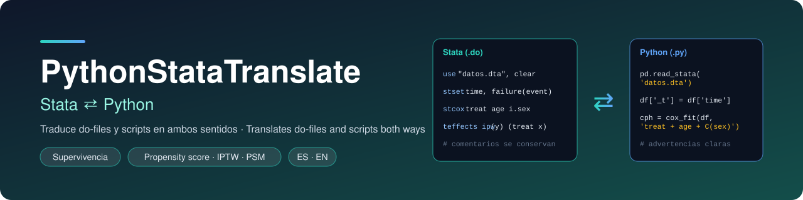

<p align="center">
  
</p>

<p align="center">
  <a href="https://github.com/cgt1989/PythonStataTranslate/releases/latest"></a>
  
  
</p>

<p align="center"><b><a href="#español">Español</a> · <a href="#english">English</a></b></p>

---

## Español

Aplicación de escritorio para Windows (`.exe`) que traduce **do-files de Stata → scripts de Python** y **scripts de Python → do-files de Stata**. Conserva los comentarios y, cuando algo no se puede traducir, te explica **por qué** (por ejemplo, Stata no tiene machine learning nativo).

### Descarga

Baja `PythonStataTranslate.exe` desde [**Releases**](https://github.com/cgt1989/PythonStataTranslate/releases/latest). No necesitas instalar Python para usar la app.

### Uso

1. Elige la dirección (**Stata → Python** o **Python → Stata**) o pulsa **Abrir archivo…**: la dirección se detecta por la extensión `.do` / `.py`.
2. Pulsa **Traducir**. A la derecha aparece el resultado y abajo las **advertencias**.
3. **Guardar…** o **Copiar salida**.
4. El selector **Idioma** cambia la interfaz y las advertencias entre español e inglés. **A− / A+** (o `Ctrl` + rueda del ratón) cambian el tamaño del texto.

### Qué traduce de Stata a Python

| Área | Comandos |
|---|---|
| **Datos** | `use`, `import`, `save`, `export`, `generate`, `replace`, `egen`, `drop`, `keep`, `rename`, `sort`, `merge`, `append`, `collapse`, `reshape`, `label`, `recode`, `xtile`, `encode`/`decode`, `destring`/`tostring`, `duplicates`, `input`, `preserve`/`restore`, `sample`, `levelsof` |
| **Descriptivos** | `summarize` (con `detail`), `tabstat`, `tabulate` (`row col chi2 exact missing gen()`), `table`, `codebook`, `describe`, `ci`, `mean`, `count`, `list` |
| **Inferencia** | `ttest` (1 muestra, 2 grupos, pareado), `prtest`/`prtesti`, `sdtest`, `swilk`, `sktest`, `oneway`, `anova`, `kwallis`, `ranksum`, `signrank`, `spearman` |
| **Epidemiología** | `cc`/`cs` (con `by()`), `cci`, `csi`, `tabi`, `iri`, `logistic` (odds ratios), `lintrend` |
| **Modelos** | `regress`, `logit`, `logistic`, `probit`, `poisson`, `nbreg`, `mlogit`, `ologit`, `oprobit`, `glm`, `qreg`, `xtreg`, `ivregress`; notación `i.` `c.` `#` `##`; `robust`, `cluster`; ponderadores `[pweight=]` `[fweight=]` `[aweight=]` `[iweight=]` |
| **Postestimación** | `predict` (`xb`, `residuals`, `rstudent`, `hat`, `cooksd`), `estat` (`hettest`, `gof`, `vif`, `ic`, `classification`), `margins`/`marginsplot`, `testparm`, `lrtest`, `estimates store`, `lroc`, `rvfplot` |
| **Supervivencia** | `stset` (`failure`, `scale`, `origin`, `enter`), `stdescribe`, `stsum`, `strate`, `sts graph/list/test/generate`, `stcox` (`strata`, `robust`, `cluster`, `[pw=]`, `nohr`), `streg` (weibull, lognormal, loglogistic), `estat phtest`, `stcurve`, `predict` (`hr`, `xb`, `martingale`, `deviance`) |
| **Propensity score** | `pscore`, `teffects psmatch/ipw/ra/aipw`, `psmatch2`, IPTW con `[pweight=]`, `tebalance summarize`, `pbalchk`, `teffects overlap` |
| **Gráficos** | `graph bar/box/export`, `histogram`, `twoway`, `scatter`, `kdensity`, `qnorm`, `aaplot` (matplotlib) |
| **Programación** | `local`, `global`, `scalar`, `display`, `foreach`, `forvalues`, `while`, `if`/`else`, `capture`, `quietly`, `by`/`bysort`, macros, abreviaturas de comandos |

Acepta abreviaturas de Stata (`tabu`, `summ`, `des`…). Los comandos sin equivalente automático (`svy`, `mi`, `stcrreg`, `esttab`…) quedan como `# TODO` con la librería de Python sugerida.

### De Python a Stata (cobertura más acotada)

Lectura y escritura de datos (`read_csv/excel/stata`, `to_csv/to_stata/to_excel`), columnas (`df["x"] = …` → `generate`/`replace`, `np.where` → `cond()`), filtros (`drop`, `dropna`, `query`, booleanos), `rename`, `sort_values`, `drop_duplicates`, `merge`, `groupby` → `collapse`/`egen`, modelos de `statsmodels.formula` → `regress`/`logit`/`probit`/`poisson` (con `vce()`), `predict`, `for`/`range`/`if`/`while`, `print` → `display`, histogramas y dispersión. Aún **no** cubre supervivencia ni propensity score en esta dirección.

### Ejecutar los scripts generados

El script de Python que produce la app usa estas librerías:

```bash
pip install -r requirements.txt
```

`lifelines` (solo para supervivencia) exige pandas 2.x, así que pip puede cambiar tu versión de pandas.

### Advertencias que genera

- **Machine learning** (`sklearn`, `torch`, `tensorflow`, `xgboost`…): Stata no lo tiene de forma nativa; sugiere `lasso`/`elasticnet`, `pystacked` o un bloque `python:` (Stata 16+).
- **Valores missing:** en Stata `x > 5` es verdadero si `x` es missing; en pandas es falso.
- **Sin equivalente automático / sintaxis no reconocida:** cada fallo indica el **motivo**.
- **Diferencias numéricas conocidas:** `margins` sin errores estándar; `teffects` con error estándar por bootstrap; `stcox` usa Efron para empates (Stata, Breslow); `use` lee las etiquetas de valor como códigos numéricos.

### Límites

Es una traducción por reglas: cubre lo más común, no todo Stata ni todo Python. **Revisa siempre el resultado** y compara una salida contra Stata con tus datos antes de confiar en un análisis. Las pruebas automáticas ejecutan el código generado con datos simulados, no con datos reales.

### Desde el código fuente

```bash
python app.py                 # abrir la interfaz
python test_traductor.py      # pruebas (la ejecución real requiere las librerías de requirements.txt)
build.bat                     # generar el .exe (requiere PyInstaller)
```

---

## English

Windows desktop app (`.exe`) that translates **Stata do-files → Python scripts** and **Python scripts → Stata do-files**. It keeps your comments and, when something cannot be translated, it tells you **why** (for example, Stata has no native machine learning).

### Download

Get `PythonStataTranslate.exe` from [**Releases**](https://github.com/cgt1989/PythonStataTranslate/releases/latest). You do not need Python installed to use the app.

### Usage

1. Pick the direction (**Stata → Python** or **Python → Stata**) or click **Open file…**: the direction is detected from the `.do` / `.py` extension.
2. Click **Translate**. The result appears on the right and the **warnings** below.
3. **Save…** or **Copy output**.
4. The **Language** selector switches the interface and warnings between Spanish and English. **A− / A+** (or `Ctrl` + mouse wheel) change the text size.

### What it translates from Stata to Python

| Area | Commands |
|---|---|
| **Data** | `use`, `import`, `save`, `export`, `generate`, `replace`, `egen`, `drop`, `keep`, `rename`, `sort`, `merge`, `append`, `collapse`, `reshape`, `label`, `recode`, `xtile`, `encode`/`decode`, `destring`/`tostring`, `duplicates`, `input`, `preserve`/`restore`, `sample`, `levelsof` |
| **Descriptives** | `summarize` (with `detail`), `tabstat`, `tabulate` (`row col chi2 exact missing gen()`), `table`, `codebook`, `describe`, `ci`, `mean`, `count`, `list` |
| **Inference** | `ttest` (one-sample, two groups, paired), `prtest`/`prtesti`, `sdtest`, `swilk`, `sktest`, `oneway`, `anova`, `kwallis`, `ranksum`, `signrank`, `spearman` |
| **Epidemiology** | `cc`/`cs` (with `by()`), `cci`, `csi`, `tabi`, `iri`, `logistic` (odds ratios), `lintrend` |
| **Models** | `regress`, `logit`, `logistic`, `probit`, `poisson`, `nbreg`, `mlogit`, `ologit`, `oprobit`, `glm`, `qreg`, `xtreg`, `ivregress`; `i.` `c.` `#` `##` notation; `robust`, `cluster`; weights `[pweight=]` `[fweight=]` `[aweight=]` `[iweight=]` |
| **Postestimation** | `predict` (`xb`, `residuals`, `rstudent`, `hat`, `cooksd`), `estat` (`hettest`, `gof`, `vif`, `ic`, `classification`), `margins`/`marginsplot`, `testparm`, `lrtest`, `estimates store`, `lroc`, `rvfplot` |
| **Survival** | `stset` (`failure`, `scale`, `origin`, `enter`), `stdescribe`, `stsum`, `strate`, `sts graph/list/test/generate`, `stcox` (`strata`, `robust`, `cluster`, `[pw=]`, `nohr`), `streg` (weibull, lognormal, loglogistic), `estat phtest`, `stcurve`, `predict` (`hr`, `xb`, `martingale`, `deviance`) |
| **Propensity score** | `pscore`, `teffects psmatch/ipw/ra/aipw`, `psmatch2`, IPTW with `[pweight=]`, `tebalance summarize`, `pbalchk`, `teffects overlap` |
| **Graphs** | `graph bar/box/export`, `histogram`, `twoway`, `scatter`, `kdensity`, `qnorm`, `aaplot` (matplotlib) |
| **Programming** | `local`, `global`, `scalar`, `display`, `foreach`, `forvalues`, `while`, `if`/`else`, `capture`, `quietly`, `by`/`bysort`, macros, command abbreviations |

Stata abbreviations are accepted (`tabu`, `summ`, `des`…). Commands with no automatic equivalent (`svy`, `mi`, `stcrreg`, `esttab`…) are left as `# TODO` with a suggested Python library.

### From Python to Stata (narrower coverage)

Data input/output (`read_csv/excel/stata`, `to_csv/to_stata/to_excel`), columns (`df["x"] = …` → `generate`/`replace`, `np.where` → `cond()`), filters (`drop`, `dropna`, `query`, boolean masks), `rename`, `sort_values`, `drop_duplicates`, `merge`, `groupby` → `collapse`/`egen`, `statsmodels.formula` models → `regress`/`logit`/`probit`/`poisson` (with `vce()`), `predict`, `for`/`range`/`if`/`while`, `print` → `display`, histograms and scatter plots. It does **not** yet cover survival analysis or propensity scores in this direction.

### Running the generated scripts

The Python script produced by the app uses these libraries:

```bash
pip install -r requirements.txt
```

`lifelines` (survival analysis only) requires pandas 2.x, so pip may change your pandas version.

### Warnings it produces

- **Machine learning** (`sklearn`, `torch`, `tensorflow`, `xgboost`…): Stata has no native support; it suggests `lasso`/`elasticnet`, `pystacked` or a `python:` block (Stata 16+).
- **Missing values:** in Stata `x > 5` is true when `x` is missing; in pandas it is false.
- **No automatic equivalent / unrecognized syntax:** every failure states the **reason**.
- **Known numerical differences:** `margins` without standard errors; `teffects` with bootstrapped standard errors; `stcox` uses Efron for ties (Stata, Breslow); `use` reads value labels as numeric codes.

### Limitations

This is a rule-based translation: it covers the most common constructs, not all of Stata or all of Python. **Always review the output** and compare a result against Stata with your own data before relying on an analysis. The automated tests run the generated code on simulated data, not real data.

### Run from source

```bash
python app.py                 # open the GUI
python test_traductor.py      # tests (real execution needs the libraries in requirements.txt)
build.bat                     # build the .exe (requires PyInstaller)
```
